# Admin redesign — Shadcnblocks references

Requested by the owner on 2026-11-01. This replaces the previous PR #5 visual
direction for the staff admin. The existing CRM actions, permissions, routes,
tenant boundaries and typed API remain the product's behavior.

## References reviewed

- Live reference: <https://shadcnblocks-admin.vercel.app/ecommerce/dashboard-1>.
  Browser inventory covered 117 linked pages across ecommerce (23), project
  management (18), payments (23), AI tools (33), tasks (9), original admin (8),
  and authentication (3). All returned successful responses. Page screenshots
  and headings were captured locally; representative dashboard, customer
  detail, board, and settings screens informed the implementation.
- Owner-provided `admin-kit-shadcnblocks/shadcn-admin-1.0.0`: sidebar, header,
  theme, settings and table structures.
- Owner-provided blocks: `application-shell/application-shell1.tsx`,
  `stats-card/stats-card1.tsx`, and `chart-card/chart-card1.tsx`. Their layout
  and component patterns are adapted to the CRM's existing shared shadcn UI.
- Template license: Shadcnblocks.com License, copyright 2024 Shadcnblocks.com;
  supplied by the owner for a customized end product.
- Owner-provided Linear screenshots inform the compact filter and display
  menus: icon triggers, a Table/Board toggle, ordering and property chips.
  These contain only existing CRM settings and private saved views.

## Product mapping

| Reference pattern                              | CRM implementation                                                                              |
| ---------------------------------------------- | ----------------------------------------------------------------------------------------------- |
| Grouped application sidebar and compact header | Workspace and Manage navigation, site context, page finder, theme control                       |
| Ecommerce KPI strip                            | Actual received/completed/pending/cancelled lead totals and existing type-specific outcomes     |
| Chart cards and category breakdown             | Daily lead volume, top partners, and a linked stage-distribution panel                          |
| Customer and issue tables                      | Lead table with clearer headers, names and contact details, roomy rows, filters and saved views |
| Customer detail                                | Lead record identity header, order/property cards, tasks and timeline                           |
| Project board and task lists                   | Existing stage board and task groups with softer columns and clearer boundaries                 |
| Settings sidebar                               | General, properties/layouts, plans, email and background jobs with active-route context         |
| Document management                            | Useful entry point to the existing lead-bound document review workflow                          |

The dashboard uses backend counts. The reference's sample revenue, percentage
changes, billing, AI tools and unrelated product modules are not CRM features.

## Implementation

The owner clarified that the live website's styling takes priority over the
local template. The admin retains neutral gray surfaces with restrained blue primary
controls and selected navigation (owner refinement, 4 Nov 2026), Inter typography, 32px navigation rows, 56px header and 24px desktop
page padding. Outlined header icons, inset KPI separators, thin line/area
charts and flat settings sections follow the live reference. Status colors
retain their semantic meanings.

The admin defaults to light mode. A browser-local `gt-sales-theme` preference supports dark mode and is
applied before paint. Palette, table, card, chart-grid and responsive-shell
styles live in `apps/admin/src/app/crm-theme.css`, scoped to `.crm-ui`.
Shared UI tokens continue to serve other applications independently.

`ThemeToggle`, `QuickNavigation` (Ctrl/Cmd K), and `SettingsNavigation` use
existing accessible shared components. The page finder searches navigation
labels only. It does not request contacts or lead data. Status colors include
contrasting light and dark variants. Reduced-motion preferences are respected.

No new dependency, API shape, environment variable or migration is needed.

Owner refinements place the website switcher at the top of the sidebar in place
of the CRM branding. The inbox starts with type tabs, search and compact icon
menus for Filters, View options and Saved views. View options holds Table/Board,
ordering, table/property columns and board preferences; saved-view selection,
saving, renaming and deletion remain in the Saved views menu. The separate
filter toolbar is removed. Lead names have no avatar icon,
and dark-mode board cards use a slightly darker surface than their columns.
Switching All leads to Board follows the visible tab order, choosing SIM orders
first when available; an explicitly selected lead type is preserved.
Record property sections hide unanswered fields in read mode and retain them
under Edit; zero and No remain visible as populated values.
Activity history uses connected timeline markers with dates above each event,
retaining the existing event descriptions and newest-first order.
The record header separates the name, type and order-number badges, received
time, labeled Stage/Assignee controls and action row. Copy info and Archive
remain available according to permissions; the delivery-letter print action is
temporarily hidden on both panel and full-page records.
The task form uses a full-width title, labeled date and assignee controls,
an open-task count badge and a separate action row. Task behavior is unchanged.
All native select options and groups use explicit theme colors, including a
muted color for disabled choices, so OS popup defaults cannot mix a light
background with dark-mode text. Browser checks measure option contrast in both themes.

Loading states use the shared admin `crm/loading-skeleton.tsx` layouts and the
existing UI Skeleton primitive. The dashboard reserves its metrics, charts and
follow-ups layout; lead tables keep their actual headers with matching skeleton
rows, and records and boards reserve their tabs, fields, sections and columns.
Tasks, reports, workspace access, team, jobs, properties, plans, email settings/
preview and automation lists/editors/run details also use skeletons. Placeholders
are decorative with a spoken loading status, respect reduced motion, and do not
show fake zero counts. Existing refresh data and error/empty states are retained.

The lead slide-out follows the tab layout in the owner's Twenty CRM screenshot
and local reference (`H:/twenty`, `PageLayoutTabsRenderer.tsx`), retaining the
CRM's own visual tokens and cards. Home contains the contact, properties, source,
related requests and change-request decisions; Tasks, Notes, Files and Activity
separate the existing work. The name, stage, assignee and actions remain above
the selected content. Tabs support keyboard navigation and keep drafts mounted
while inactive. Contact-only tabs retain the existing permission checks. The
full-page record keeps its two-column layout. No email inbox or calendar is added.

The slide-out opens over 420 ms and closes over 360 ms with ease-in-out motion.
Its desktop width and gap animate with it, smoothly narrowing and expanding the
table. Content stays mounted through the exit; reduced-motion preferences skip
the transition. Selecting another record cancels a pending close.
The entry state resets while the panel is closed, so repeated opens start from
zero width rather than briefly mounting at full width and reversing direction.
Board cards open this same slide-out from the name or card body, keeping board
filters and layout in the URL. Move controls and dragging remain independent;
modifier clicks retain normal link behavior. Closing returns focus to the card.
Boards with horizontal overflow have a viewport-bottom dock with left/right
arrows and a draggable, keyboard-accessible scroll slider. The dock follows
native board scrolling, disables arrows at either end, respects reduced motion
and resizes beside an open lead panel. Bottom space keeps the last cards clear.

## Verification

Component coverage includes theme switching/storage, keyboard page finding,
dashboard filtering, lead columns, permissions and existing CRM interactions.
The real-backend browser suite additionally checks theme persistence after a
reload, settings navigation, representative screens, and narrow-screen layout.
Final command results and screenshots are recorded with the pull request.

Verified locally: 2,484 unit/integration tests (213 files, none skipped), 47
tooling tests, 14 public desktop/mobile browser checks, and all 15 real-backend
lead journeys normally and under UTC. Production build, typecheck, lint and
format checks passed. The regenerated OpenAPI is unchanged.

The current refinement passes all 485 admin tests and all 16 backend
browser journeys. Draft retention, note saving, keyboard tab navigation,
permissions and the mobile sheet are covered. Admin/UI typechecks, repository
lint and formatting pass; the final mobile spacing also passes its focused
browser journey.

Motion coverage includes close completion, cancellation and reduced motion.
All 63 panel/inbox tests pass after updating close assertions for the transition;
the other 425 admin tests pass in the full run. All 17 browser journeys pass
across the full and focused runs, including desktop/mobile tabs and table width
samples at the start, middle and end of both transitions. Admin typecheck, lint
and formatting pass.

Board slide-out verification passes 67 board/inbox component tests, the desktop/
mobile board journey and the existing table-resize journey. Production build,
admin typecheck, targeted lint and formatting checks pass.

Viewport navigation checks cover arrow scrolling, keyboard slider endpoints,
fixed positioning during vertical page scroll, alignment beside the record
panel and mobile width. Both board browser journeys and all 67 board/inbox
component tests pass; the production build and targeted lint pass.

The header refinement passes all 65 lead-record component tests and the
desktop/mobile tabbed-record browser journey, including visible field labels,
action permissions, copying and the hidden print action. Production build,
admin typecheck, targeted lint and formatting pass; screenshots are refreshed.

The loading refinement passes all 489 admin tests, production build, admin
typecheck, lint and formatting. All 19 existing backend browser journeys pass;
the additional delayed-response journey passes in a focused run. It checks
dashboard, table, record, board and email settings placeholders, real-data
replacement, visible column alignment, mobile width and reduced motion.

The repeat-open regression reproduces a reversed second entrance before the
fix. It now checks three open/close cycles without reloading in both table and
board layouts, including intermediate list widths and reduced motion. All three
focused browser journeys, 63 panel/inbox tests, production build, admin
typecheck, targeted lint and formatting pass.

Settings regrouping passes the navigation/direct-reload browser journey on
desktop and mobile, all seven team/credential component tests, production
build, targeted lint and formatting. It creates no invitations or credentials.

The public staff sign-in, invitation, recovery and access-denied pages use a
shared branded frame. The authentication forms and redirects retain their
existing behavior.

Settings separates profile (General), teammate access and invitations (Team,
`settings/team`) and website service credentials (Integrations,
`settings/integrations`). The existing forms and owner permission checks are
reused on their new pages.

## Screenshots

These screenshots use the disposable browser-test database's synthetic data.

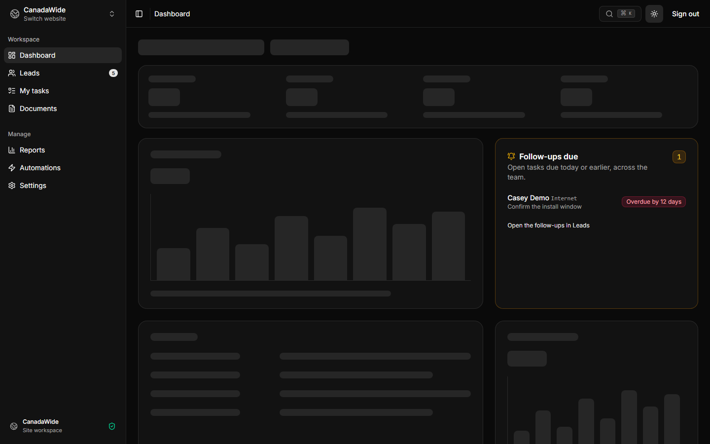

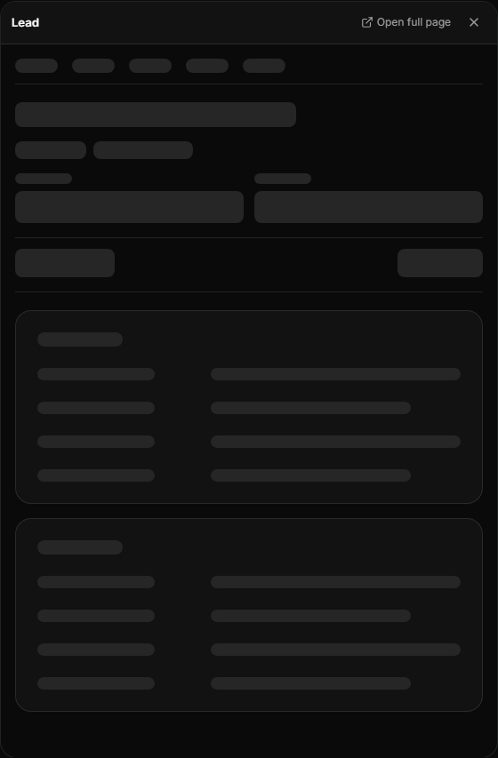

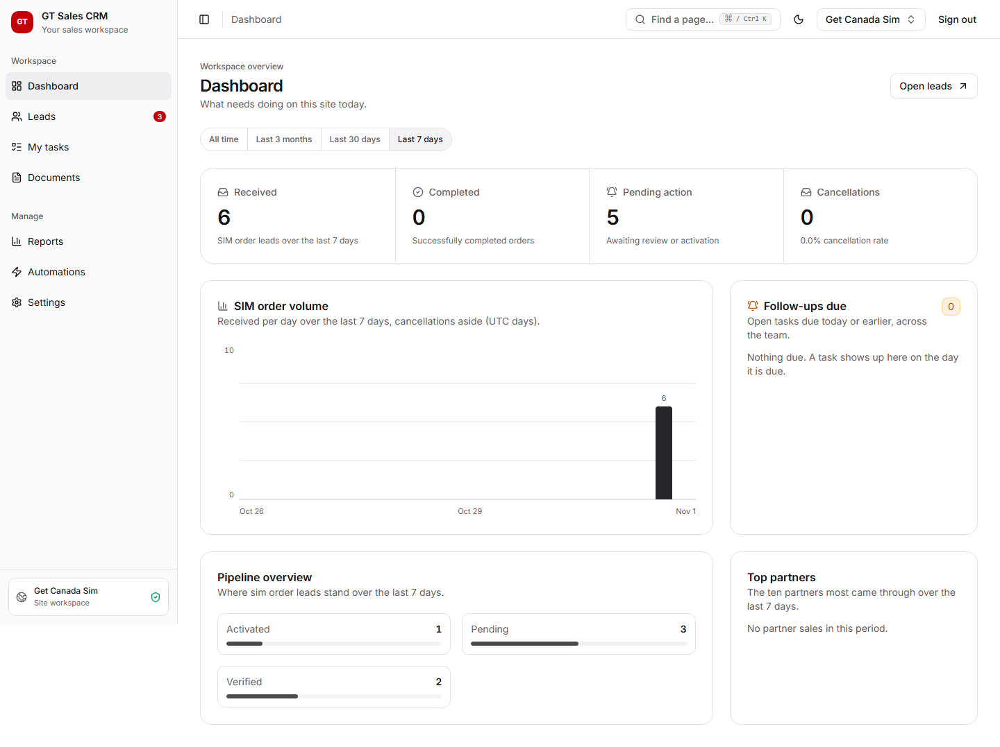

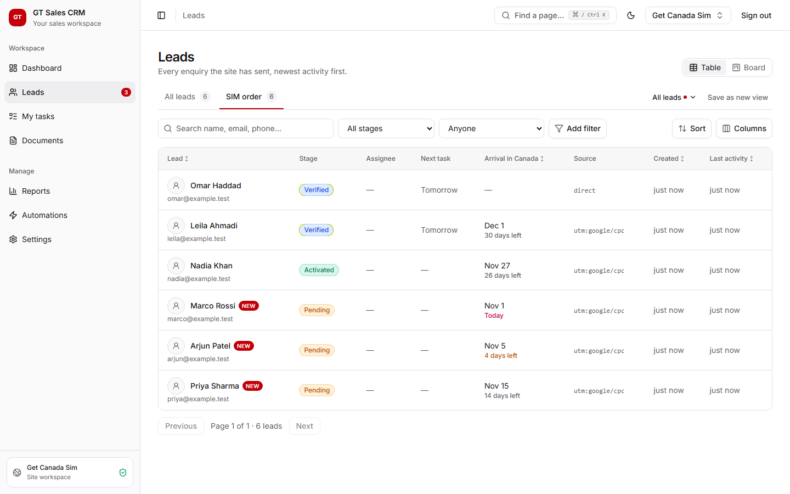

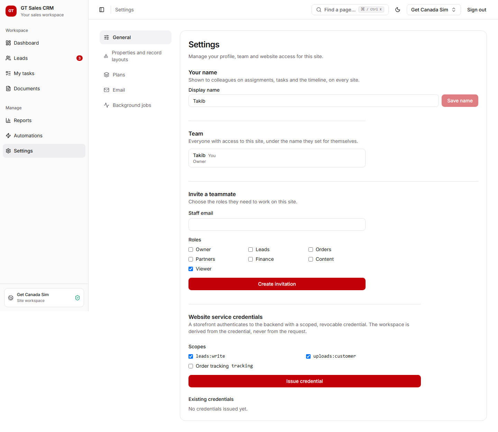

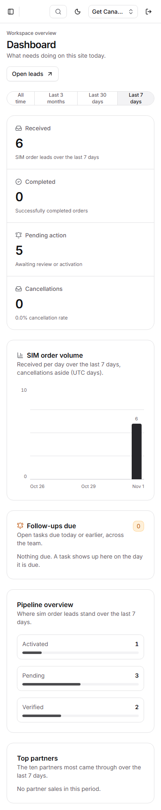

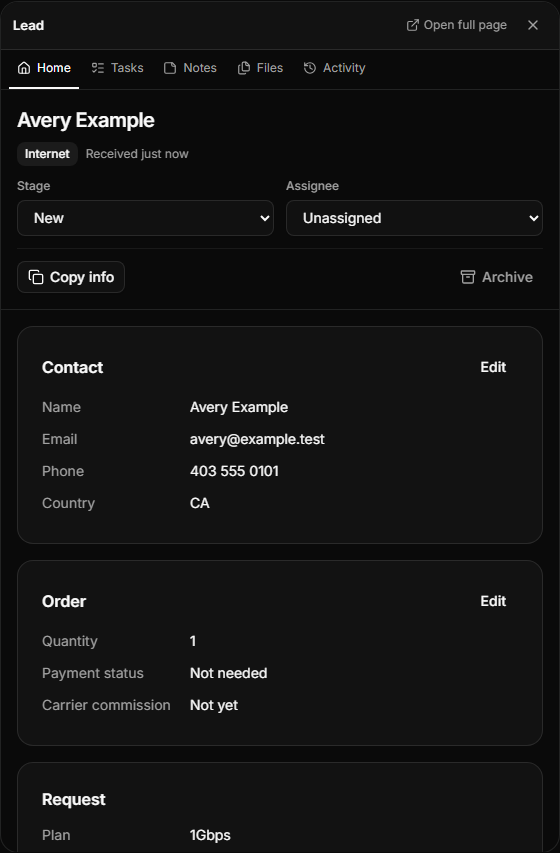

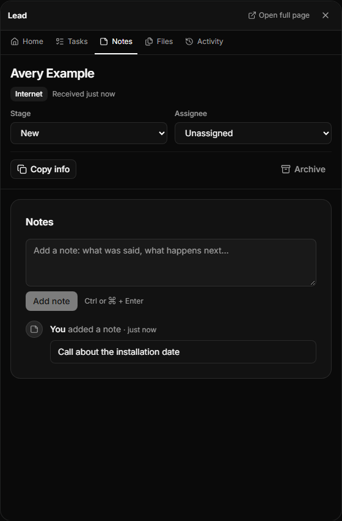

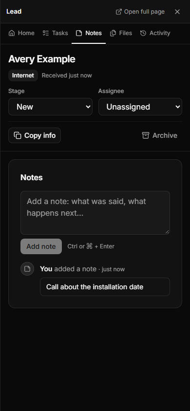

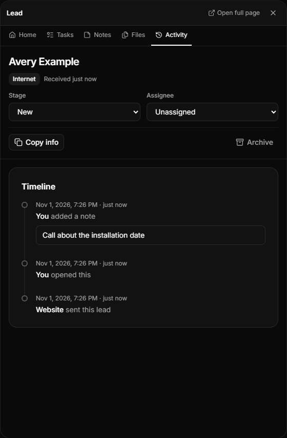

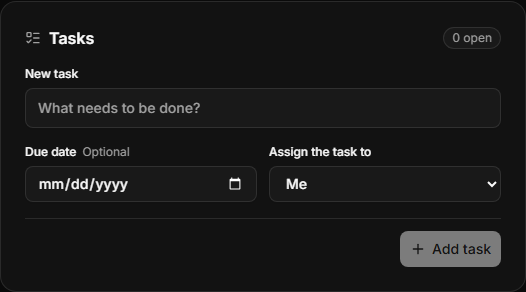

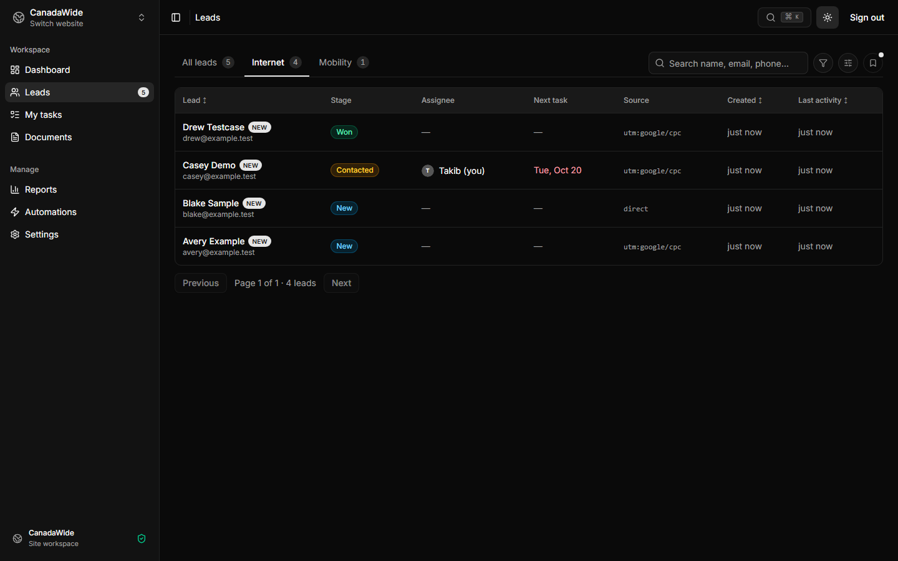

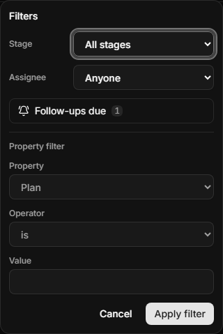

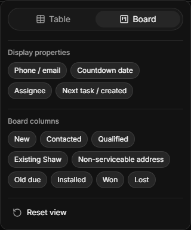

The restrained color pass uses blue for actions, focus, active tabs, filters and
chart series. Dashboard icon tiles use green for completed outcomes, amber for
waiting work and rose for cancellations; values and page backgrounds stay neutral.
Both themes have explicit contrasting pairs. Existing stage and warning labels
remain visible, so color supplements the meaning.
