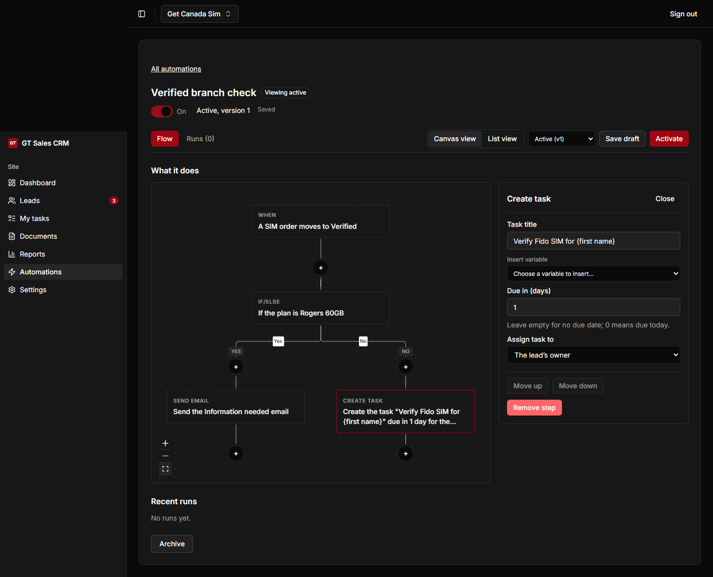

# Phase 8 Step B review — 2026-11-01

Reviewed the implementation at `5bd5a72` against the Step A base `b9e6139`,
the supplied task and the owner-approved
[automation flows spec](../superpowers/specs/2026-10-31-phase-8-automation-flows-design.md).

## Standards

The permission and backend-only database boundaries remain intact. Customer
test emails use synthetic property values and omit unavailable or private
properties. No migrations or API contract changes were required.

The review found unsafe asynchronous state handling: older autosave responses
could replace newer edits, and version actions could race saves. Saves now run
in order with revision and edit-generation guards. Activation, discard, reset
and archive coordinate with pending saves; switching off remains possible when
a draft has a conflict. Historical version requests ignore obsolete responses.

The full Windows gate also exposed existing portability defects outside Step B.
The fixes use PostgreSQL's complete `--quote-all-identifiers` option, accept CRLF
tool output and SQL fixtures, use platform-aware basenames in tests, and handle
Windows stdin EOF like a broken pipe while preserving the child's exit status.
Actual backup/restore rehearsal and regression tests cover these fixes.

## Spec

Corrected these missing or incorrect behaviors:

- Revision conflicts now show the required Reload recovery and retain edits.
- Run details load the run's immutable definition and refreshed step outcomes,
  so subsequent edits cannot relabel historical actions.
- List view supports the same editing and insertion controls as the canvas;
  the shared step panel moves actions within their path.
- Property inputs match their kinds, including labelled choices and Yes/No.
- Adding an If/else checks the depth of existing descendants moved into Yes.
- React Flow loads dynamically on the editor page.
- Validation issues appear on the affected cards and in the panel; permission
  controls remain disabled with an explanation.
- Draft/version labels match the displayed definition, including read-only views.
- Overlap warnings refresh after activation and switching.
- Insertion menus paint above existing cards. The browser journey exercises
  inserting before a card, as well as building and running the branched flow.
- Fixed-position React Flow wrappers explicitly accept pointer events, so
  cards and insertion buttons work in a real browser. Zoom controls follow the
  admin's dark/light colors, and unfinished drafts show setup guidance.
- Corrected the new browser journey's button names and explicit trigger/type
  selection, which had prevented it from reaching the actual editor.

Regression coverage includes slow saves with subsequent edits, conflicting
drafts, archive preservation, keyboard menus, focus return, list editing,
movement, typed fields, nested depth limits, and historical run descriptions.

## Verification and release

Verified locally on disposable PostgreSQL 17 databases:

- Lint, typecheck and Prettier: passed.
- Unit and integration suites: 2,482 tests across 211 files passed, none skipped.
- Tooling: 47 tests passed.
- Contracts build: passed; generated OpenAPI unchanged.
- Production admin build: passed.
- Real-backend browser journeys: 14 passed normally and 14 passed under `TZ=UTC`.

An earlier browser run alongside the full suite timed out in an existing
lead-table test; the isolated normal and UTC runs passed without retries.

No production settings, records or automations were changed during this review.
The original task requires the owner's OK before merging. Deployment and the
production smoke check therefore follow that approval.
